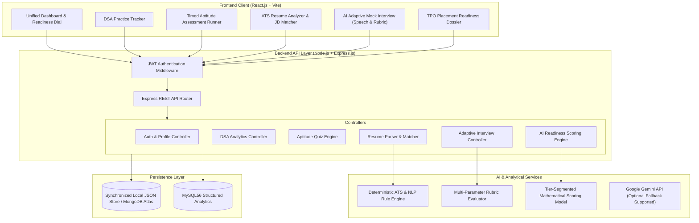

# System Architecture & Technical Specifications
## AI-Based Placement Preparation and Readiness Tracking System
**Institution:** Govt. Engineering College, Ajmer (GECA)  
**Project Code:** GECA/CSE/2026  
**Candidate:** Ganpat Singh (Roll No: 23IT17)  

---

## 1. System Block Diagram & Data Flow

---

## 2. Multi-Tier Readiness Scoring Mathematical Formula

The synopsis specifies that placement preparedness must be evaluated across **four core preparation pillars**:
1. $S_{DSA}$: Data Structures & Algorithms Score ($0 - 100$)
2. $S_{Apt}$: Standardized Aptitude & Core CS Score ($0 - 100$)
3. $S_{Res}$: ATS Resume Quality & Relevancy Score ($0 - 100$)
4. $S_{Int}$: Technical Mock Interview Rubric Score ($0 - 100$)

Because different industries demand radically different skill distributions, our system implements a **Tier-Segmented Weighting Model**:

### Tier 1: Product-Based Companies (e.g., Google, Microsoft, Amazon, Atlassian)
Product firms prioritize deep algorithmic problem solving and system scalability.
$$\text{Readiness}_{\text{Tier-1}} = 0.40 \cdot S_{DSA} + 0.20 \cdot S_{Apt} + 0.15 \cdot S_{Res} + 0.25 \cdot S_{Int}$$
*Institutional Cutoff Benchmark:* **78%**

### Tier 2: Service-Based Companies (e.g., TCS Digital/Prime, Infosys DSE, Wipro, Accenture)
Service firms emphasize broad aptitude agility, verbal communication, and foundational OOP/DBMS.
$$\text{Readiness}_{\text{Tier-2}} = 0.15 \cdot S_{DSA} + 0.35 \cdot S_{Apt} + 0.20 \cdot S_{Res} + 0.30 \cdot S_{Int}$$
*Institutional Cutoff Benchmark:* **68%**

### Tier 3: Core Engineering & PSU (e.g., ISRO, DRDO, BEL, Embedded/Technical)
Core roles mandate heavy emphasis on Operating Systems, Networks, Computer Architecture, and Aptitude.
$$\text{Readiness}_{\text{Tier-3}} = 0.10 \cdot S_{DSA} + 0.45 \cdot S_{Apt} + 0.25 \cdot S_{Res} + 0.20 \cdot S_{Int}$$
*Institutional Cutoff Benchmark:* **70%**

---

## 3. Pillar Metric Calculation Details

### A. DSA Metric ($S_{DSA}$)
Evaluated using a weighted difficulty point model:
- Easy Problem: $2\text{ points}$
- Medium Problem: $5\text{ points}$
- Hard Problem: $10\text{ points}$

$$\text{VolumeScore} = \min\left(100, \frac{\sum \text{Points}}{45} \times 100\right)$$
$$\text{TopicCoverage} = \min\left(1.0, \frac{\text{Unique Topics Solved}}{6}\right)$$
$$S_{DSA} = 0.75 \cdot \text{VolumeScore} + 0.25 \cdot (\text{TopicCoverage} \times 100)$$

### B. Aptitude Metric ($S_{Apt}$)
Timed testing across 4 categories (Quantitative, Logical, Verbal, Core CS):
$$S_{Apt} = \frac{1}{N} \sum_{i=1}^N \text{ScorePercentage}_i$$

### C. Resume ATS Metric ($S_{Res}$)
Computed across 5 dimensions:
1. Keyword & Skills Match vs Target JD ($35\%$)
2. Quantifiable Impact & Action Verbs ($20\%$)
3. ATS Section Structure & Parsing ($15\%$)
4. Project & Experience Depth ($15\%$)
5. Contact & Educational Baseline ($15\%$)

### D. Mock Interview Metric ($S_{Int}$)
Assessed dynamically over multi-stage interview questioning against 4 rubrics:
- Technical Accuracy ($35\%$)
- Problem Solving Approach ($30\%$)
- Clarity of Communication ($20\%$)
- Completeness & Edge Case Handling ($15\%$)

---

## 4. Database Schema Specification

1. **`users`**: `{ id, email, passwordHash, name, role, createdAt }`
2. **`profiles`**: `{ id, userId, name, rollNo, college, branch, semester, cgpa, targetTier, targetRole, skills }`
3. **`dsa_problems`**: `{ id, userId, title, topic, difficulty, platform, url, completed, notes, timeSpentMin, completedAt }`
4. **`aptitude_results`**: `{ id, userId, category, totalQuestions, correctCount, scorePercentage, timeTakenSeconds, topicBreakdown, completedAt }`
5. **`resume_analyses`**: `{ id, userId, fileName, targetRole, atsScore, matchScore, breakdown, matchedKeywords, missingKeywords, strengths, improvements, analyzedAt }`
6. **`mock_interviews`**: `{ id, userId, role, tier, tierName, overallScore, rubric: { technicalAccuracy, problemSolving, communication }, questionsAnswered, feedback, completedAt }`
7. **`readiness_scores`**: `{ id, userId, targetTier, primaryScore, status, pillars, tierScores, actionRoadmap, calculatedAt }`
